**Senior Mobile Engineer** — building Android iOS apps, SDKs, and developer tools used across 150+ countries.

---

## Currently Building

---

## Shipped

| | | |
|:--|:--|:--|
| **[AndroidSensors](https://github.com/AkshayAshokCode/AndroidSensors)** | Professional sensor toolkit for Android | **4k+** installs · **150+** countries · **95%** organic · [Google Play](https://play.google.com/store/apps/details?id=com.akshayAshokCode.androidsensors) |
| **[DevFocus for VS Code](https://github.com/AkshayAshokCode/vscode-devfocus)** | Focus timer & day planner for VS Code / Cursor | <!-- VSCODE_DEVFOCUS_DOWNLOADS_START -->**2704+** downloads<!-- VSCODE_DEVFOCUS_DOWNLOADS_END --> · [Open VSX](https://open-vsx.org/extension/akshayashokcode/devfocus) |
| **[DevFocus](https://github.com/AkshayAshokCode/DevFocus)** | Pomodoro timer inside your IDE | <!-- DEVFOCUS_DOWNLOADS_START -->**494+** downloads<!-- DEVFOCUS_DOWNLOADS_END --> · **18** IDEs on [JetBrains Marketplace](https://plugins.jetbrains.com/plugin/30114-devfocus) |
| **[MediaKit](https://github.com/AkshayAshokCode/MediaKit-android)** | Modular Android media SDK | Published on [Maven Central](https://central.sonatype.com/namespace/io.github.akshayashokcode) |

---

## Featured

**[AndroidSensors](https://github.com/AkshayAshokCode/AndroidSensors)** — Sensor toolkit on the Play Store. Bubble level, metal detector, gravity meter, and more — built with Jetpack Compose. Improved Play Store conversion rate from **22% → 30%** through store listing experiments. Highest adoption in the US, India, Mexico, and Brazil.

**[DevFocus for VS Code](https://github.com/AkshayAshokCode/vscode-devfocus)** — Focus timer and day plan for engineers working with AI — sessions, real breaks, and a defensible end to the day. Runs in VS Code, Cursor, and other VSCode-API editors, distributed via Open VSX.

**[MediaKit](https://github.com/AkshayAshokCode/MediaKit-android)** — Modular Android media SDK. Gallery, camera, and crop workflows with a single fluent API. Available on Maven Central.

**[DevFocus](https://github.com/AkshayAshokCode/DevFocus)** — Productivity plugin for JetBrains IDEs. Focus modes, circular session tracking, status bar integration, and smart notifications — all without leaving the editor. Zero external dependencies, published via automated CI/CD. Strongest adoption in Germany.

**[YoutubeAndroid](https://github.com/AkshayAshokCode/YoutubeAndroid)** — A ready-made starting point for building YouTube features on Android. **13** working, drop-in examples with the hard parts already solved — so you build your product instead of fighting the API docs.

---

## Engineering Philosophy

I enjoy learning, building, and understanding how things work beneath the surface.

I'm naturally curious about systems, workflows, and user behavior — especially how people interact with products, what they expect while using them, and the small frustrations they experience along the way.

I enjoy solving problems, taking ownership, and continuously improving products through thoughtful details, performance, usability, and real user feedback.

For me, engineering is a constant process of curiosity, experimentation, problem-solving, and growth.

---

## Beyond Engineering

Football ⚽ · [Chess](https://www.chess.com/member/akshayashokcode) · Fitness 💪

---

## GitHub Stats

<picture>
  <source media="(prefers-color-scheme: dark)" srcset="./assets/github-stats-dark.svg">
  <source media="(prefers-color-scheme: light)" srcset="./assets/github-stats-light.svg">
  
</picture>

---

### Currently Listening To 

<a href="https://open.spotify.com/user/dd7o8yr5pft0b4qvntfk8o1zu">
  <picture>
    <source media="(prefers-color-scheme: dark)" srcset="https://spotify-now-playing-nine-drab.vercel.app/api/orchestrator?background_color=0d1117&border_color=0d1117">
    <source media="(prefers-color-scheme: light)" srcset="https://spotify-now-playing-nine-drab.vercel.app/api/orchestrator?background_color=ffffff&border_color=ffffff">
    
  </picture>
</a>
